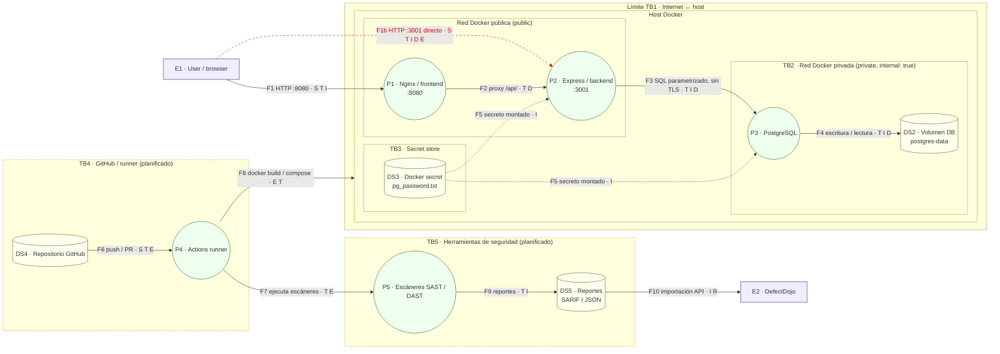

# Modelo de amenazas STRIDE — MoonPhases (Diario de Observación Lunar)

Documento de la **Fase 1 · Threat Modeling STRIDE**. Se elabora antes de la explotación automática de resultados (SAST/DAST), porque sirve de marco para interpretar esos hallazgos posteriormente.

Hallazgos priorizados y explicados: [stride-register.md](stride-register.md).

## 1. Alcance y método

- **Sistema analizado:** servicios definidos en [compose.yaml](../../compose.yaml) (`postgres`, `backend`, `frontend`), la configuración de [frontend/nginx.conf](../../frontend/nginx.conf), los Dockerfiles y el código de [backend/src/server.js](../../backend/src/server.js) y [backend/src/db.js](../../backend/src/db.js).
- **Fuera de alcance por ahora:** GitHub, Actions runner, escáneres de seguridad y DefectDojo. Estos componentes aparecen en el DFD porque forman parte del flujo DevSecOps planificado, pero **no existen todavía en el repositorio** (no hay `.github/workflows/`). Sus amenazas se marcan como *anticipadas*.
- **Metodología:** STRIDE aplicado por elemento del DFD. Cada amenaza tiene un identificador y un estado.

### Leyenda de estados

| Estado | Significado |
|---|---|
| **Confirmada** | Evidencia directa en el código o en la configuración actual. |
| **Candidata** | Riesgo plausible que depende de un supuesto (despliegue, host, red) aún no verificado. |
| **Mitigada** | Existe un control, aunque puede tener riesgo residual. |
| **Anticipada** | Componente planificado que todavía no existe; amenaza prevista. |

### Leyenda STRIDE

| Letra | Categoría | Pregunta que responde |
|---|---|---|
| **S** | Spoofing (suplantación) | ¿Puede alguien hacerse pasar por otro actor o componente? |
| **T** | Tampering (manipulación) | ¿Puede alterarse datos o código en tránsito o en reposo? |
| **R** | Repudiation (repudio) | ¿Puede negarse una acción sin que quede rastro? |
| **I** | Information disclosure (fuga) | ¿Puede exponerse información a quien no debe verla? |
| **D** | Denial of service (denegación) | ¿Puede degradarse o caer el servicio? |
| **E** | Elevation of privilege (escalada) | ¿Puede obtenerse más privilegio del permitido? |

## 2. Diagrama DFD (Mermaid)

Convención de notación DFD:

- **Entidad externa** (rectángulo): `E1`, `E2`.
- **Proceso** (círculo): `P1`…`P5`.
- **Almacén de datos** (cilindro): `DS1`…`DS5`.
- **Flujo de datos**: `F*`, con las categorías STRIDE aplicables entre corchetes.
- **Línea discontinua roja**: flujo que no debería existir o que evita un control (ver `S-02`).
- **Subgrafos**: límites de confianza (*trust boundaries*).

> El diagrama usa la sintaxis de Mermaid `flowchart`. Si se visualiza en GitHub o VS Code con extensión de Mermaid, se renderiza directamente.

## 3. Límites de confianza (trust boundaries)

| ID | Límite | Cruza | Observación |
|---|---|---|---|
| TB1 | Internet ↔ host | F1, F1b | El host expone `8080` (frontend) y `3001` (backend). |
| TB2 | Red pública ↔ red privada | F3 | PostgreSQL solo está en `private` (`internal: true`), y la red `private` no tiene salida a Internet. |
| TB3 | Contenedores ↔ secret store | F5 | El secreto se monta en `/run/secrets/pg_password`. |
| TB4 | GitHub ↔ runner | F6, F8 | Entrada de código no confiable (PR, forks). |
| TB5 | Runner ↔ Docker daemon | F8 | Quien controla el daemon tiene privilegios de root en el host. |
| TB6 | Herramientas ↔ DefectDojo | F9, F10 | Los reportes pueden contener secretos o detalles de vulnerabilidades. |

## 4. Matriz STRIDE por elemento

Cada celda contiene los identificadores de amenaza (detallados en la sección 5). Un guion indica que no aplica.

| Elemento | S | T | R | I | D | E |
|---|---|---|---|---|---|---|
| **E1** User / browser | S-01 | — | — | — | — | — |
| **P1** Nginx / frontend | — | T-03, T-04 | — | I-02 | D-01 | — |
| **P2** Express / backend | S-01, S-02 | T-01, T-02, T-05 | R-01 | I-01 | D-01 | — |
| **P3** PostgreSQL | — | T-04 | — | I-03 | — | — |
| **DS2** Volumen DB | — | — | — | I-04 | — | — |
| **DS3** Docker secret | — | — | — | I-05 | — | — |
| **P4** Actions runner | A-02 | A-02 | — | — | — | A-01 |
| **DS4** Repositorio GitHub | A-03 | A-03 | — | — | — | — |
| **P5** Escáneres | — | — | — | A-04 | — | — |
| **DS5** Reportes | — | A-04 | — | A-04 | — | — |
| **E2** DefectDojo | — | — | A-04 | A-04 | — | — |

> Los identificadores `A-xx` son amenazas anticipadas de la fase CI/CD y DefectDojo. Se listan en la sección 5.2.

## 5. Catálogo de amenazas

### 5.1 Amenazas de la aplicación (confirmadas o candidatas)

| ID | STRIDE | Elemento / flujo | Descripción | Evidencia | Estado | Severidad |
|---|---|---|---|---|---|---|
| **S-01** | S | E1, P2 · F1 | La API no tiene autenticación ni identidad de usuario. Cualquiera puede actuar como "el" usuario. El propio esquema lo declara: "sin autenticación de usuario". | [server.js](../../backend/src/server.js) (sin middleware de auth); [schema.sql:2](../../backend/db/schema.sql) | Confirmada | Alta |
| **S-02** | S | P2 · F1b | El backend publica `3001:3001` en el host. Un cliente puede llegar a la API sin pasar por Nginx, por lo que cualquier control añadido en el proxy se evita. | [compose.yaml:26-27](../../compose.yaml) | Confirmada | Alta |
| **T-01** | T | P2 · F1b, F2 | `POST /api/notes` y `DELETE /api/notes/:date` modifican o borran notas de cualquier fecha sin autorización. | [server.js:43](../../backend/src/server.js), [server.js:64](../../backend/src/server.js) | Confirmada | Alta |
| **T-02** | T | P2 · F2 | Entradas sin validación. `:date` no se valida como `YYYY-MM-DD` y `content` no tiene longitud máxima ni tipo verificado. Las consultas sí están parametrizadas, así que no hay inyección SQL evidente. | [server.js:27-31](../../backend/src/server.js), [server.js:43-47](../../backend/src/server.js) | Confirmada | Media |
| **T-03** | T | P1 · F1 | Nginx no envía cabeceras de seguridad (`Content-Security-Policy`, `X-Content-Type-Options`, `X-Frame-Options`, `Referrer-Policy`, HSTS). | [nginx.conf](../../frontend/nginx.conf) (sin `add_header`) | Confirmada | Media |
| **T-04** | T | P1, P2, P3 · imágenes | Las imágenes base se referencian por tag, no por digest (`node:20-alpine`, `nginx-unprivileged:alpine`, `postgres:16.3-alpine`). Un tag puede cambiar sin que el proyecto lo note. | [backend/Dockerfile:1](../../backend/Dockerfile), [frontend/Dockerfile:1,13](../../frontend/Dockerfile), [compose.yaml:3](../../compose.yaml) | Confirmada | Media |
| **T-05** | T | P2 · F1b | `app.use(cors())` responde `Access-Control-Allow-Origin: *`. Cualquier página web que el usuario visite puede leer y escribir en la API si el navegador puede alcanzarla. | [server.js:6](../../backend/src/server.js) | Confirmada | Media |
| **R-01** | R | P2 | Las escrituras y borrados no registran quién, cuándo ni desde dónde. No hay logs de auditoría ni identidad. | [server.js:43-74](../../backend/src/server.js) | Confirmada | Media |
| **I-01** | I | P2 · F1 | Los errores devuelven `err.message` al cliente. Un error de PostgreSQL puede revelar nombres de tabla, columnas y detalles del motor. | [server.js:22](../../backend/src/server.js), [:38](../../backend/src/server.js), [:59](../../backend/src/server.js), [:71](../../backend/src/server.js) | Confirmada | Media |
| **I-02** | I | P1 · F1 | El tráfico del usuario viaja en HTTP plano en el puerto `8080`. No hay TLS configurado. | [nginx.conf:2](../../frontend/nginx.conf) (`listen 8080`, sin `ssl`) | Confirmada | Media |
| **I-03** | I | P2 → P3 · F3 | La conexión a PostgreSQL no usa TLS (`db.js` no define `ssl`). El riesgo está acotado porque la red es interna. | [db.js:15-21](../../backend/src/db.js) | Candidata | Baja |
| **I-04** | I | DS2 | El volumen `postgres-data` no está cifrado en reposo. Depende del cifrado de disco del host. | [compose.yaml](../../compose.yaml) (volumen local sin cifrado) | Candidata | Baja |
| **I-05** | I | DS3 | El secreto es un archivo en texto plano (`pg_password.txt`) en el host. Está excluido de Git y no entra en las imágenes, pero sigue siendo legible por cualquiera con acceso al host. | [.gitignore](../../.gitignore), [compose.yaml:56-57](../../compose.yaml) | Mitigada (riesgo residual) | Baja |
| **D-01** | D | P1, P2 | No hay límite de tasa (`limit_req`) ni tamaño de cuerpo configurado en Nginx (por defecto `client_max_body_size` es 1 MB). Tampoco hay límite lógico en `content`. Una ráfaga de peticiones puede saturar el backend o el disco. | [nginx.conf](../../frontend/nginx.conf), [server.js:7](../../backend/src/server.js) (`express.json()` sin opciones) | Confirmada | Media |

### 5.2 Amenazas anticipadas (componentes planificados)

| ID | STRIDE | Elemento / flujo | Descripción | Estado | Severidad |
|---|---|---|---|---|---|
| **A-01** | E | P4 · F8 | El runner tiene acceso al Docker daemon. Quien controle el daemon puede montar el host y obtener root. | Anticipada | Alta |
| **A-02** | S, T | P4 · F6 | Un PR desde un fork puede ejecutar un workflow con secretos, o usar acciones de terceros sin pin a SHA. | Anticipada | Alta |
| **A-03** | S, T | DS4 · F6 | La rama `main` puede modificarse sin revisión si no hay protección de rama. | Anticipada | Media |
| **A-04** | I, R | P5 · F9, DS5 · F10, E2 | Los reportes pueden contener secretos o detalles explotables. Sin trazabilidad, no se sabe quién importó o cerró cada hallazgo. | Anticipada | Media |

## 6. Controles existentes (evidencia positiva)

Estos controles reducen el riesgo y deben conservarse en las fases siguientes:

- **PostgreSQL no se publica en el host.** Solo es accesible desde la red `private`, que es `internal: true` (TB2). — [compose.yaml:15, 63-65](../../compose.yaml)
- **Procesos sin privilegios de root.** El backend ejecuta `USER node` y el frontend usa `nginxinc/nginx-unprivileged`. — [backend/Dockerfile:11](../../backend/Dockerfile), [frontend/Dockerfile:13](../../frontend/Dockerfile)
- **Build multietapa.** La imagen final del frontend solo contiene Nginx y `dist/`. No incluye código fuente ni dependencias de desarrollo. — [frontend/Dockerfile](../../frontend/Dockerfile)
- **Secreto fuera de la imagen.** La contraseña se entrega como Docker secret, y `pg_password.txt` está en `.gitignore`. — [compose.yaml:56-57](../../compose.yaml), [.gitignore](../../.gitignore)
- **Consultas parametrizadas** (`$1`, `$2`) en todas las operaciones SQL. — [server.js](../../backend/src/server.js)
- **Dependencias fijadas por lockfile** (`npm ci`) en backend y frontend.
- **Healthchecks** en PostgreSQL y backend.

## 7. Próximos pasos (entrada a las fases siguientes)

1. **SAST / DAST:** usar la sección 5.1 para interpretar los hallazgos. Un hallazgo que coincide con un ID ya documentado se prioriza; uno nuevo se agrega aquí.
2. **Correcciones prioritarias:** S-01/T-01 (autenticación y autorización), S-02 (no publicar `3001`), D-01 (límites), I-01 (errores genéricos).
3. **CI/CD y DefectDojo:** cuando exista `.github/workflows/`, revisar A-01 a A-04 y actualizar el estado.
